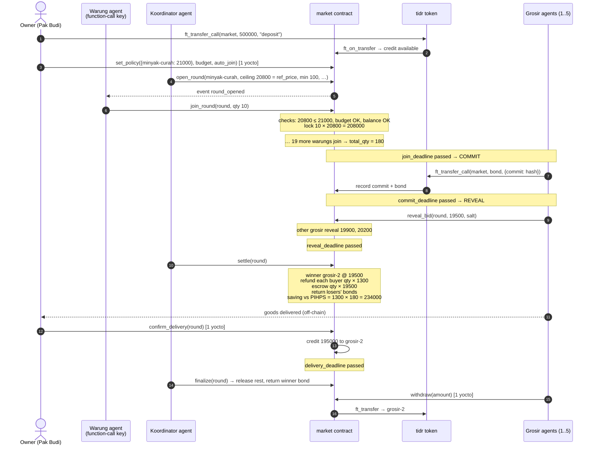

# Koelakan: Market Rules

> Status: **v0.3. Implemented in `contracts/market` (41 unit tests).**
> Track: AI Swarms (`swarms`), also Real-World Money (`realworld`)

Small Indonesian shops (*warung*) buy in small quantities at retail prices. In the PIHPS data of 11 Nov 2026, national average rice and sugar prices were already above the official HET retail ceiling (see `data/prices.json`). In Koelakan, each warung has an agent. The agents pool their orders into one wholesale lot, and supplier agents (*grosir*) compete for that lot in a sealed-bid auction. A NEAR contract holds all money in escrow and enforces each owner's limits, so an agent key (limited to `join_round`) cannot withdraw a warung's funds. This is unaudited testnet code.

**What makes this different from generic group-buying swarms:**

1. **Real prices, not invented ones.** Every catalogue item has an on-chain *reference price* taken from Indonesia's official national food-price panel (PIHPS Nasional), with its source and date (see §1a). A round's ceiling can never exceed the reference price, so every rupiah of saving we report is measured against the price a warung really pays today.
2. **Built for the existing supply chain.** Sellers are local *grosir*, distributors or a Koperasi Desa Merah Putih. They complement it rather than compete with it. The arbiter is meant to be a local cooperative.
3. **Owner UX like a chat.** In the dashboard, an owner sees each agent decision as a WhatsApp-style message ("Ikut patungan minyak curah 10 kg @ maks Rp20.800? → YA").

This file is the single source of truth. The Rust contract, the TypeScript simulation engine and the dashboard all implement exactly these rules.

---

## 1. Actors and accounts

Every agent has its own sub-account under one parent, so each on-chain action can be traced to a specific agent.

| Actor | Account (testnet) | Role |
|---|---|---|
| Market contract | `market.<root>.testnet` | Coordinator: rounds, escrow, auctions, policies |
| Test token | `tidr.<root>.testnet` | `tIDR`, a NEP-141 test rupiah stablecoin (0 decimals, 1 tIDR = Rp1). It stands in for IDRX/USDC |
| Warung (buyer) | `warung-01 … warung-20.<root>.testnet`, or **any** testnet account (judges) | Joins rounds, pays its share |
| Warung agent | function-call key on the warung's account | Joins rounds within the owner's policy |
| Grosir (seller) | `grosir-1 … grosir-5.<root>.testnet` | Posts a bond, commits and reveals sealed bids, delivers goods |
| Coordinator agent | `koordinator.<root>.testnet` | Opens rounds when enough demand exists (any warung may also open one) |
| Arbiter | `arbiter.<root>.testnet` (set at init) | Resolves delivery disputes only |
| Admin | `<root>.testnet` (set at init) | Adds catalogue items and changes the arbiter. It cannot touch any balance |

`<root>` is the parent account chosen at deploy time (for example `koelakan.testnet`). Any testnet account may act as a warung or as a grosir; the sub-accounts are the ones our own agents use.

**Test token faucet.** `tidr.faucet()` mints 1,000,000 tIDR to the caller, at most once per account per hour, and registers the caller's storage on the token, which is needed to receive transfers (NEP-145). The deploy script registers `market` on `tidr`.

## 1a. Catalogue and reference prices

Each catalogue item is stored on-chain as `{ id, name, unit, ref_price, het, source, as_of }`:

- `ref_price` is the national average **market** price from PIHPS Nasional. This is what a warung realistically pays now.
- `het` is the official retail price ceiling (*harga eceran tertinggi*), when one exists. It is shown for context only.
- The admin adds or updates items with `set_item(...)`. An update only affects rounds opened afterwards.
- Seed values live in `data/prices.json`, which links to its sources. The initial catalogue (prices from 11 Nov 2026 PIHPS Nasional, HET from Surat Edaran Kepala Bapanas No. 456/2026):

| id | unit | ref_price (PIHPS, 11 Nov 2026) | HET (zone 1) |
|---|---|---|---|
| `beras-medium` | kg | 16,650 (medium, type II) | 13,500 |
| `gula-pasir` | kg | 19,950 (local) | 17,500 |
| `telur-ayam` | kg | 28,350 | 30,000 |
| `minyak-curah` | kg | 20,800 | n/a |

Market prices for rice and sugar are already **above** the HET. That is exactly the gap that pooled wholesale buying targets.

## 2. Money model

All amounts are integers in tIDR (rupiah).

1. **Deposit.** A warung owner tops up its *saldo patungan* by calling `ft_transfer_call` on `tidr` with receiver `market` and `msg = "deposit"`. The contract credits the warung's internal **available balance**.
2. **Lock.** Joining a round moves `qty × ceiling_price` from available to **locked** for that round.
3. **Refund of difference.** When the round settles at `clearing_price ≤ ceiling_price`, `qty × (ceiling_price − clearing_price)` returns to available right away.
4. **Payment.** `qty × clearing_price` stays in escrow until delivery is confirmed (§6), then it is credited to the winning grosir's available balance.
5. **Withdraw.** Anyone can withdraw their available balance to their own account with `withdraw(amount)`. The balance is debited first, then `ft_transfer` is sent. If that transfer fails (for example the receiver is not registered on `tidr`), a callback credits the amount back.

**Token gate.** `ft_on_transfer` only accepts calls whose predecessor is the configured `tidr` account. A call from any other token, or with an unknown `msg`, returns the full amount and changes nothing.

**Rounding.** All splits use integer floor division. Any remainder (dust) goes to the buyer with the largest `qty`. A tie goes to whoever joined first. Nothing is ever lost or created.

**Invariant (tested):** the contract's tIDR balance always equals the sum of all available balances, locked funds, escrowed payments and seller bonds.

## 3. Owner policy (set once in the frontend, enforced on-chain)

The owner sets this policy with `set_policy`. Each warung has:

| Field | Meaning | Example |
|---|---|---|
| `max_price[item]` | Highest unit price the warung will accept per item | `minyak-curah → 21000` |
| `weekly_budget` | Maximum tIDR locked or spent per 7-day window | `1500000` |
| `auto_join` | `true`: the agent may join without asking. `false`: only the owner may join | `true` |

The contract enforces these in `join_round`, so it is the contract that refuses, not the agent that decides:

- `round.ceiling_price ≤ policy.max_price[round.item]`, otherwise `join_round` panics.
- `spent[week] + qty × ceiling_price ≤ weekly_budget`, otherwise it panics. Here `week = floor(block_timestamp / 7 days)` at join time. The participation record stores that week, and any later refund for the round is subtracted from **that same week's** counter (saturating at 0).
- If `auto_join == false`, only a full-access key may call `join_round`. This is checked by requiring 1 yoctoNEAR to be attached.
- An item missing from `max_price` cannot be joined.

The check uses the ceiling, not the final price, on purpose. The funds locked are `qty × ceiling_price`, which is the worst case, so the owner's limit holds no matter which bid wins.

## 4. Keys: agent permission without custody

| Method | Who can call | How it is enforced |
|---|---|---|
| `set_policy`, `withdraw`, `confirm_delivery`, `dispute` | **Owner only** (full-access key) | `assert_one_yocto()`. Function-call keys cannot attach deposits |
| `join_round` | Owner, or the agent (function-call key) | Function-call key restricted to `receiver = market`, `methods = ["join_round"]` |
| `open_round`, `settle`, `finalize` | Anyone | Permissionless. The outcome is fully determined by state |

So the worst a stolen agent key can do is join rounds that the owner's policy already allows. It cannot withdraw, transfer, confirm or change the policy. The key also has a small NEAR gas allowance (for example 0.25 NEAR), so it cannot drain the account through gas.

Where the agent key lives:

- **Our 20 simulated warungs:** the key is held by the agent service, in `.env` (never committed).
- **A judge's own account:** the dashboard signs in through NEAR Wallet Selector with `contractId = market` and `methodNames = ["join_round"]`. The wallet creates exactly this restricted key, the key stays in the judge's browser, and the in-browser agent uses it.

Seller agents sign with their own full-access keys, because committing a bond requires attaching 1 yocto to `ft_transfer_call`.

## 5. Round lifecycle

```
OPEN ──join_deadline──▶ COMMIT ──commit_deadline──▶ REVEAL ──reveal_deadline──▶ settle()
                                                                                  │
                         ┌──────────────── no valid bid or qty < min_total_qty ───┤
                         ▼                                                        ▼
                      FAILED                                                   SETTLED
                (everything refunded)                                            │
                                                         delivery_deadline ──▶ finalize() ──▶ CLOSED
```

**Time.** Phases are derived from `block_timestamp`. No transaction is needed to move between phases, except `settle` and `finalize`. With `t` the current block time:

| Phase | Condition |
|---|---|
| OPEN (join) | `t < join_deadline` |
| COMMIT | `join_deadline ≤ t < commit_deadline` |
| REVEAL | `commit_deadline ≤ t < reveal_deadline` |
| ready to settle | `t ≥ reveal_deadline`, **or** `t ≥ join_deadline` with `total_qty < min_total_qty` (the round is already doomed, so it can be failed early) |
| DELIVERY | after settle and `t < delivery_deadline` |

**Limits (to stay within gas).** A round has at most **50 participants** and **10 bids**. `settle` and `finalize` loop over both, and these caps keep each call well under 300 Tgas. A join or commit beyond a cap is rejected.

### 5.1 Open
`open_round(item, ceiling_price, min_total_qty, join_secs, commit_secs, reveal_secs, delivery_secs)`

- `item` must be in the catalogue, which the admin manages (`beras-medium`, `gula-pasir`, `telur-ayam`, `minyak-curah`, …).
- `1 ≤ ceiling_price ≤ item.ref_price`. This is the highest unit price any bid may have. By default the dashboard sets it to `ref_price`. The round stores a copy of `ref_price` so its savings can be reported later: `saving = (ref_price − clearing_price) × total_qty`.
- `min_total_qty ≥ 1` is the smallest lot a supplier will sell at wholesale.
- Each duration must be between 30 s and 30 days. The deadlines are set from the current block time: `join_deadline = now + join_secs`, `commit_deadline = join_deadline + commit_secs`, and so on. In the demo they are short (for example 120 / 60 / 60 / 300 s).

### 5.2 Join (state OPEN, before `join_deadline`)
`join_round(round_id, qty)` with `qty ≥ 1`.

- The policy checks in §3 must pass, and `available ≥ qty × ceiling_price`.
- One join per warung per round. There is no leaving and no topping up in v1.
- `total_qty` increases by `qty`.

### 5.3 Commit (state COMMIT, after `join_deadline` and before `commit_deadline`)
Total demand is now fixed. A grosir commits by sending a bond:

`ft_transfer_call(receiver = market, amount = bond, msg = {"commit": {"round_id": N, "hash": "<hex>"}})`

- Commits are only accepted if `total_qty ≥ min_total_qty`. Otherwise the round is doomed, and no one should lock a bond in it.
- `bond = ceil(5% × ceiling_price × total_qty)`. Any other amount is returned in full and the commit is rejected.
- `hash = sha256("{round_id}:{seller_account_id}:{unit_price}:{salt}")` as lowercase hex. The seller's account is part of the hash so one seller cannot copy another's commitment.
- One commit per seller per round.
- The `salt` must be at least 16 random bytes (hex). The seller agent must save `(price, salt)` before sending the commit. If it loses them, it cannot reveal, and its bond is forfeited.

### 5.4 Reveal (state REVEAL, before `reveal_deadline`)
`reveal_bid(round_id, unit_price, salt)`

A bid is **valid** when the hash matches and `1 ≤ unit_price ≤ ceiling_price`. A matching reveal with a price above the ceiling is recorded as invalid but still counts as revealed.

### 5.5 Settle (after `reveal_deadline`, callable by anyone, once)

- **FAILED** if `total_qty < min_total_qty` or there is no valid bid. In that case:
  - every buyer's locked amount returns to available;
  - every **revealed** seller's bond is returned;
  - every **unrevealed** seller's bond is forfeited and split among buyers pro rata to `qty`.
- **SETTLED** otherwise:
  - The winner is the lowest valid `unit_price`. A tie goes to the earlier commit (order of commits).
  - `clearing_price = winner.unit_price`. This is a first-price sealed-bid auction, so the winner is paid its own bid.
  - Each buyer gets `qty × (ceiling_price − clearing_price)` back right away, and `qty × clearing_price` moves to escrow.
  - Losing revealed sellers get their bonds back. Unrevealed sellers' bonds are forfeited to buyers pro rata.
  - The winner's bond stays locked until finalize.

## 6. Delivery

During SETTLED, before `delivery_deadline`, each buyer does **one** of the following:

| Action | Effect |
|---|---|
| `confirm_delivery(round_id)` (owner only) | That buyer's escrowed payment is credited to the winner right away |
| `dispute(round_id)` (owner only) | That buyer's payment is frozen until the arbiter rules |
| nothing | Treated as accepted at finalize. Silence means acceptance, so a buyer cannot hold a seller's payment hostage |

`resolve_dispute(round_id, buyer, refund_buyer: bool)` can be called by the **arbiter only**:

- `true`: the buyer gets its payment back **plus** its pro-rata share of the winner's bond (`bond × qty / total_qty`).
- `false`: the payment goes to the winner.

The arbiter has until `arbiter_deadline = delivery_deadline + delivery_secs` to rule. After that, an unresolved dispute **defaults to refunding the buyer's payment only**, with no bond share. This way an absent arbiter can never lock funds forever, and the seller still keeps its bond.

`finalize(round_id)` can be called by anyone after `delivery_deadline`:

- Undisputed, unconfirmed payments go to the winner.
- If disputes are still open and `t < arbiter_deadline`, finalize stops there. It can be called again later.
- Once no dispute is open (resolved, or defaulted after `arbiter_deadline`), the winner's bond, minus the shares paid to buyers through disputes, goes back to the winner, and the state becomes CLOSED.

## 7. Events (NEP-297 JSON logs, standard `koelakan`)

`item_set`, `policy_set`, `deposit`, `withdraw`, `withdraw_refunded`, `round_opened`, `joined`, `bid_committed`, `bid_revealed`, `bonds_forfeited`, `round_settled`, `round_failed`, `delivery_confirmed`, `disputed`, `dispute_resolved`, `round_finalize_partial`, `round_finalized`.

The dashboard reads view methods and these events. It keeps no state of its own.

## 8. Views

`get_config()`, `get_items()`, `get_round(id)` and `list_rounds(from, limit)` (each round includes its participants, its bids (a price is `null` until revealed), its derived `phase` and its `saving`), `get_balance(account)` (available and held), `get_policy(account)`, `get_spent(account, week?)`, `get_required_bond(id)`.

## 9. Agents and simulation

- **Warung agent.** It watches open rounds and calls `join_round(qty)` when the item is in its policy, it needs stock, and the ceiling fits. In live mode an LLM may phrase the decision, but the decision itself must pass the contract checks.
- **Grosir agent.** Each grosir has a scripted `cost` and `margin` per item. Costs are set around the official HET/HPP (for example 0.85–0.97 × HET) and labelled in `sim/config` as **assumptions**. The reference prices are real data, but seller costs are not. In COMMIT it computes `unit_price = round(cost × (1 + margin))`. It bids only if `unit_price ≤ ceiling_price` and it has enough tIDR for the bond. Then it commits, and it reveals in REVEAL. In simulation, one grosir is scripted to "forget" to reveal, so the forfeit path is shown.
- **Simulation mode** (`npm run simulate`). It runs 20 warungs and 5 grosir with scripted, seeded strategies and **no LLM calls**, using a TypeScript engine that implements this file. Golden scenarios in `sim/golden/scenarios.json` are replayed by both the TypeScript engine (vitest) and the real contract code (Rust unit test, `golden_tests.rs`); both must reach the same balances and round outcomes.

## 10. Out of scope for v1 (stated honestly)

- Rupiah on-ramp and off-ramp (QRIS, bank transfer to stablecoin). The planned path is IDRX or USDC.
- Settlement through NEAR Intents (there is no testnet). The planned mainnet path is cross-chain payment to the supplier through Intents 1Click.
- Proving physical delivery. v1 relies on buyer confirmation plus an arbiter.
- Storage staking per user. On testnet the contract pays storage, but mainnet would need `storage_deposit` at registration and a small deposit on `open_round` against spam.
- Partial lots, multiple winners, leaving a round, or price-by-volume curves.

## 11. Trust assumptions

- **Arbiter.** It is a single trusted account in v1 (for example a cooperative). It can only decide disputed shares within one round. It cannot move any other funds, and its power expires at `arbiter_deadline`.
- **Admin.** It can only add or update catalogue items (which cap the ceilings of *future* rounds) and change the arbiter. It has no power over balances, open rounds or bids. In v1 the reference prices are entered by hand from the cited source. An oracle that reads PIHPS automatically is future work.
- **Contract upgrades.** The testnet deploy keeps a full-access key for fixes. A mainnet deploy would remove it or move it to a DAO.

---

## Sequence: one successful round



## Sequence: failure paths (summary)

- Not enough demand, or no valid bid: `settle` → FAILED. Buyers get everything back, revealed sellers get their bonds back, and unrevealed bonds are split among buyers.
- An agent tries to join above the owner's max price: `join_round` panics with `"ceiling above owner max_price"`. Nothing changes.
- A stolen agent key calls `withdraw`: it is rejected, because a function-call key cannot attach 1 yocto and `withdraw` is not in its method list.
- Goods never arrive: the buyer calls `dispute`, and the arbiter's `resolve_dispute(refund_buyer = true)` refunds the payment plus a bond share.
